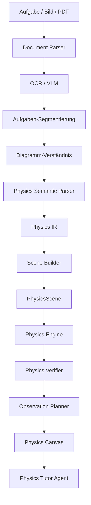
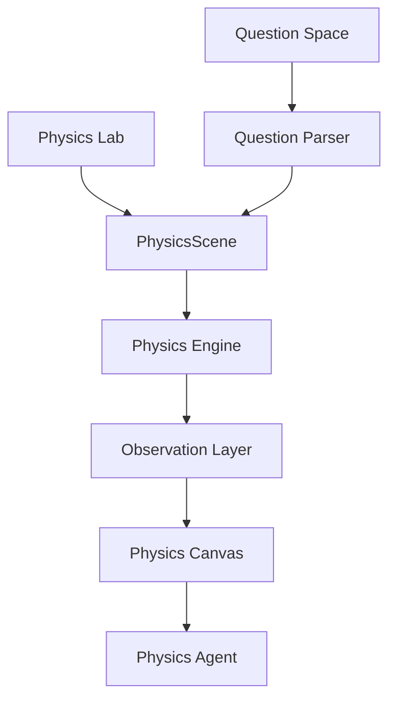
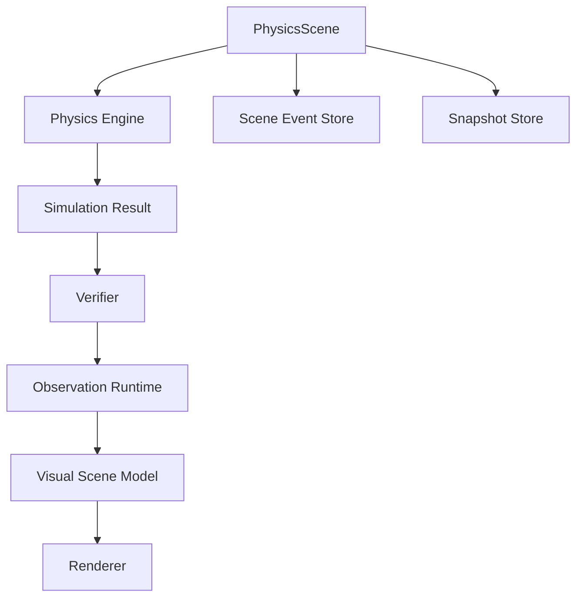
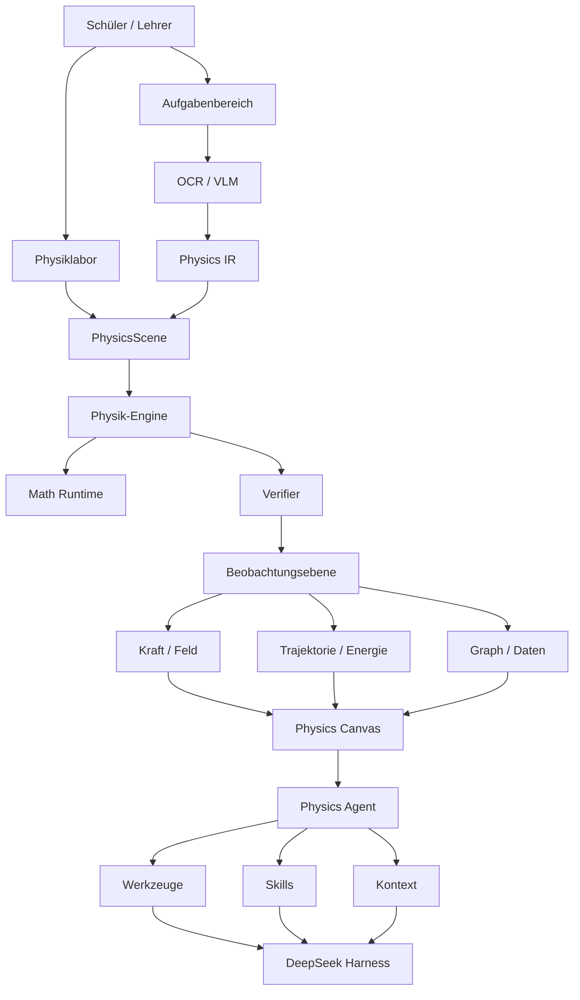

# PhysicsOS Produktübersicht und Systemarchitektur

> Datei: `docs/00-PRODUCT-OVERVIEW.md`  
> Dokumentzweck: PhysicsOS vollständige Produktdefinition und Systemarchitektur  
> **Version: Vollständige Produktarchitektur / Web First**
>
> **Produkttyp: Visualisierung und Schlussfolgerung für Physik Mittel- und Oberstufe + KI-Agent-Lernplattform**
>
> **Kernidee: Unsichtbare physikalische Prozesse sichtbar machen.**

---

# 1. Produktübersicht

## 1.1 Produktname

**PhysicsOS**

Chinesische Positionierung:

> **Visualisierung und Schlussfolgerung für Physik Mittel- und Oberstufe sowie Agent-Plattform**

PhysicsOS ist keine herkömmliche KI-Aufgaben-Suchwebsite und auch keine virtuelle Experimentierplattform, die fixe Animationen abspielt.

Es soll die grundlegendste Problemklasse im Physiklernen lösen:

> Viele physikalische Konzepte scheitern nicht daran, dass Schüler „die Formeln nicht können“, sondern daran, dass sie den physikalischen Prozess nie wirklich gesehen haben.

Beispielsweise:

- Welche Kräfte wirken tatsächlich auf einen Körper?
- Warum zeigt die resultierende Kraft in diese Richtung?
- Wie verändern sich Geschwindigkeit und Beschleunigung dynamisch?
- Wie entstehen die Bahnen von waagerechtem und schrägem Wurf sowie Kreisbewegungen?
- Wie wirkt ein elektrisches Feld genau auf ein geladenes Teilchen?
- Warum ändert die Lorentzkraft nur die Geschwindigkeitsrichtung?
- Wie wechseln die Bahnen von Teilchen, die in unterschiedliche elektrische und magnetische Felder eintreten?
- Wie beeinflussen sich bei der elektromagnetischen Induktion Geschwindigkeit, Strom und ampèresche Kraft gegenseitig?
- Was passiert tatsächlich hinter einem statischen Schemabild auf einem Prüfungsbogen?

Bisher hing das Verständnis dieser Inhalte weitgehend davon ab:

> „Stellt euch das einfach alle vor.“

Das Ziel von PhysicsOS ist es, diese Prozesse, die bisher nur durch räumliches Vorstellungsvermögen, dynamische Vorstellungskraft und abstraktes Schließen verstanden werden konnten, in eine digitale Physikwelt zu verwandeln, die:

- beobachtbar;
- pausierbar;
- ziehbar;
- parameterveränderbar;
- messbar;
- wiederholbar;
- prüfbar;
- dialogfähig;
- neu simulierbar;

ist.

---

# 2. Produktvision

PhysicsOS strebt an, zu werden:

> **Eine digitale Physikwelt-Plattform für Lehre, Lernen, Experimentieren, Aufgaben und Klassenvorführungen in der Physik der Mittel- und Oberstufe.**

Nutzer „lesen Physik“ nicht nur.

Sondern:

> **Sie betreten eine wirklich ausführbare Physikwelt.**

In PhysicsOS:

- Aufgaben werden zur Physikwelt;
- die Physikwelt kann Aufgaben generieren;
- Agents können die aktuelle Welt verstehen;
- Schüler können die aktuelle Welt direkt manipulieren;
- Lehrer können ihre eigenen physikalischen Szenen erstellen;
- ursprünglich unsichtbare Größen wie Kraft, Feld, Geschwindigkeit, Beschleunigung, Energie, Bahn werden sichtbar.

---

# 3. Produkt-Kernprinzipien

Der Kern von PhysicsOS ist nicht Chat, sondern:

```text
PhysicsScene
+
Physics Engine
+
Observation Layer
+
Physics Skills
+
Physics Agent
```

Dabei:

- **LLM** ist für Verstehen, Planen, Erklären und Aktionsauswahl zuständig;
- **Physics Engine** entscheidet, wie die Physikwelt real läuft;
- **PhysicsScene** speichert den realen Zustand der Physikwelt;
- **Observation Layer** macht unsichtbare physikalische Größen zu sichtbaren Informationen;
- **Physics Skills** beschreiben Fachwissen, Regeln, Lehrmethoden und Werkzeugstrategien;
- **DeepSeek Harness** übernimmt Agent-Lebenszyklus, Session, Tools, Prompt, Context und weitere generische Agent-Infrastruktur.

Kernarchitekturprinzip:

> **LLM entscheidet nicht über das physikalische Ergebnis, die Physics Engine entscheidet.**

---

# 4. Produktnutzer

PhysicsOS richtet sich an drei Hauptrollen.

## 4.1 Schüler

Hauptbedürfnisse:

- Abstrakte physikalische Prozesse verstehen;
- Experimente durchführen;
- Aufgaben hochladen;
- Prüfungsbögen hochladen;
- KI-Analyse;
- Visualisiertes Verständnis;
- Variantenaufgaben bearbeiten;
- Fehleraufgaben verwalten;
- Lernverlauf ansehen;
- Wissenslücken entdecken.

---

## 4.2 Lehrer

Hauptbedürfnisse:

- Physikvorführungen erstellen;
- Experimentszenen erstellen;
- KI-erstellte Klassenszenen;
- Aufgaben importieren;
- Variantenaufgaben erstellen;
- Klassenvorführung per Bildschirmübertragung;
- Experimente veröffentlichen;
- Hausaufgaben erteilen;
- Lerngruppen verwalten;
- Lernstand einsehen.

---

## 4.3 Plattformbetrieb / Content-Team

Hauptbedürfnisse:

- Kursystem-Management;
- Skill-Management;
- Experimentvorlagen-Management;
- Aufgabensammlungs-Management;
- Content-Prüfung;
- Modellkonfiguration;
- Agent-Konfiguration;
- Datenanalyse;
- Systemmonitoring.

---

# 5. Produkt-Kerngangpunkte

Die Schüleransicht behält nur zwei höchstpriorisierte Einstiegspunkte:

```text
PhysicsOS
│
├── ① Physics Lab
│      Physiklabor
│
└── ② Question Space
       Aufgabenbereich
```

Nicht aufsplitten in Erst-Einstiegspunkte:

- Mechanik;
- Elektrisches Feld;
- Magnetisches Feld;
- Stromkreis;
- Agent;
- Kraftanalyse;

Das sind nur physikalische Domänen innerhalb von PhysicsOS.

---

# 6. Physics Lab — Physiklabor

Das Kernziel von Physics Lab ist:

> **Ausgehend von physikalischen Modellen und Phänomenen eine wirklich ausführbare Physikwelt erkunden.**

Es ist nicht nur ein Schullabor mit Geräten.

Das vollständige Physics Lab enthält drei Experimentkategorien.

---

## 6.1 Simulation realer Experimente

Beispielsweise:

- Punkttimer;
- Newtons zweites Gesetz;
- Überprüfung der Energieerhaltung in der Mechanik;
- Überprüfung der Impulserhaltung;
- Überprüfung des Parallelogramms der Kräfte;
- Reibungskoeffizient messen;
- Einfaches Pendel;
- Widerstand messen;
- Elektromotorische Kraft und Innenwiderstand einer Stromquelle messen;
- Volt-Ampere-Kennlinie einer Glühlampe aufzeichnen;
- Messgeräteumbau;
- Optikversuche;
- Elektromagnetische Induktionsversuche.

---

## 6.2 Abstrakte physikalische Experimente

Dieser Teil ist eine wichtige differenzierende Fähigkeit von PhysicsOS.

Beispielsweise in der Realität nicht direkt beobachtbar:

```text
Schwerkraft
Normalkraft
Reibungskraft
Resultierende Kraft
Geschwindigkeit
Beschleunigung
Impuls
Elektrisches Feld
Elektrisches Potenzial
Lorentzkraft
Magnetischer Fluss
Energie
Momentangeschwindigkeit
```

PhysicsOS kann all dies sichtbar machen.

Beispielsweise Kräfte:

```text
            N
            ↑
            │
      f ← [■] → F
            │
            ↓
            mg
```

Diese Vektoren sind keine statischen Illustrationen, sondern ändern sich in Echtzeit mit der Szene.

---

## 6.3 Digitale Physikwelt-Experimente

Beispielsweise:

- Waagerechter Wurf;
- Schräger Wurf;
- Kreisbewegung;
- Geladenes Teilchen tritt in elektrisches Feld ein;
- Geladenes Teilchen tritt in magnetisches Feld ein;
- Elektromagnetisches Kombinationsfeld;
- Geschwindigkeitswähler;
- Massenspektrometer;
- Zyklotron;
- Elektromagnetische Induktion;
- Mehrere magnetische Feldbereiche;
- Verbundkörper;
- Doppelte Stab auf Schienen.

Der Nutzer kann modifizieren:

```text
Masse
Ladung
Anfangsgeschwindigkeit
Winkel
Position
Schwerkraft
Reibungskoeffizient
Elektrische Feldstärke
Magnetische Flussdichte
Feldrichtung
Widerstand
Stromquellenparameter
Grenze
```

Physics Engine berechnet die gesamte Welt sofort neu.

---

# 7. Physics Lab Fachabdeckung

PhysicsOS deckt die gesamte Physik der Mittel- und Oberstufe direkt in der Vollversion ab.

## 7.1 Mechanik Mechanics

```text
Mechanik
│
├── Kinematik
│   ├── Verschiebung
│   ├── Geschwindigkeit
│   ├── Beschleunigung
│   ├── Gleichförmige Bewegung
│   ├── Gleichmäßig beschleunigte Bewegung
│   ├── Freier Fall
│   ├── Senkrechter Wurf
│   ├── Waagerechter Wurf
│   └── Schräger Wurf
│
├── Kraftanalyse
│   ├── Schwerkraft
│   ├── Federkraft
│   ├── Reibungskraft
│   ├── Zugkraft
│   ├── Stützkraft
│   ├── Resultierende Kraft
│   └── Kraftzerlegung
│
├── Newtonsche Bewegungsgesetze
├── Verbundene Körper
├── Rollen
├── Federn
├── Kreisbewegung
├── Gravitation
├── Arbeit und Energie
├── Impuls
├── Stoß / Kollision
├── Schwingung
└── Welle
```

---

## 7.2 Elektrisches Feld Electric Field

Unterstützt:

```text
Punktladung
Mehrere Punktladungen
Coulombkraft
Homogenes elektrisches Feld
Überlagerung elektrischer Felder
Feldlinien (elektrisch)
Feldstärke
Elektrisches Potential
Gleichpotentialfläche
Potentialdifferenz
Potentielle Energie (elektrisch)
Elektrische Feldkraft
Kondensator
Bewegung geladener Teilchen
```

Beobachtbare Layer:

```text
Feldlinien (elektrisch)
Feldstärkevektoren
Gleichpotentiallinien
Potentialverteilung
Elektrische Feldkraft
Geschwindigkeit
Beschleunigung
Bahn / Trajektorie
Energie
```

---

## 7.3 Magnetisches Feld Magnetic Field

Unterstützt:

```text
Feldlinien (magnetisch)
Ampèresche Kraft
Lorentzkraft
Kreisbewegung geladener Teilchen
Rand-Magnetfeld
Rechteckiges Magnetfeld
Kreisförmiges Magnetfeld
Mehrzonen-Magnetfeld
Ein- und Austrittsprobleme
Kritische Probleme
Minimalfläche des Magnetfelds
Mehrteilchen-Bewegung
```

---

## 7.4 Komposite Felder EM Composite

Eigenständige Erstellung:

```text
EM Composite Engine
```

Unterstützt:

```text
Elektrisches Feld + Magnetisches Feld
Elektrisches Feld + Gravitationsfeld
Magnetisches Feld + Gravitationsfeld
Elektrisches Feld + Magnetisches Feld + Gravitationsfeld

Geschwindigkeitswähler
Massenspektrometer
Zyklotron / Zyklotronbeschleuniger
Halleffekt
Teilchenbewegung in Mehrfeldzonen
Periodische Bewegung
```

---

## 7.5 Stromkreis Circuit

Die unterliegende Schicht nutzt einen echten Circuit Graph, keine Animation.

```text
CircuitGraph
│
├── Node
├── Edge
├── Terminal
├── Component
├── Source
├── Resistor
├── Switch
├── Capacitor
├── Inductor
└── Meter
```

Unterstützt:

```text
Gleichstromkreis
Reihen- und Parallelschaltung
Dynamischer Stromkreis
Schiefer Draht / Rheostat
Voltmeter
Amperemeter
Ohmsches Gesetz für den geschlossenen Stromkreis
Innenwiderstand der Stromquelle
Kondensator
Sensor
Versuchsstromkreis
Stromkreisfehler
```

Zukünftig können Stromkreisdiagramme in Prüfungsaufgaben direkt in einen CircuitGraph umgewandelt werden.

---

## 7.6 Elektromagnetische Induktion Induction

Unterstützt:

```text
Magnetischer Fluss
Leiter schneidet magnetische Feldlinien
Faradaysches Induktionsgesetz
Lenzsches Gesetz
Drahtrahmen betritt Magnetfeld
Drahtrahmen verlässt Magnetfeld
Führungsbahn-Probleme
Zweistab-Probleme
Elektromagnetische Dämpfung
Selbstinduktion
Gegenseitige Induktion
Wechselstrom
Transformator
```

Beispiel:

```text
Geschwindigkeit sinkt
   ↓
Induzierte Spannung sinkt
   ↓
Strom ändert sich
   ↓
Ampèresche Kraft ändert sich
   ↓
Beschleunigung ändert sich
```

Gesamter Prozess in Echtzeit gekoppelt.

---

## 7.7 Weitere Bereiche

```text
Physics Engine
│
├── Mechanics
├── Kinematics
├── Collision
├── Gravitation
├── Electric
├── Magnetic
├── Electromagnetic
├── Circuit
├── Induction
├── Optics
├── Wave
├── Thermodynamics
└── ModernPhysics
```

Moderne Physik kann weiter abdecken:

- Photoelektrischer Effekt;
- Atommodell;
- Energieniveau-Übergang;
- Kernreaktion;
- Zerfall.

---

# 8. Question Space —— Aufgabenbereich

Question Space positioniert sich nicht als KI-Hausaufgabenlöser.

Sein Kernziel ist:

> **Eine statische Prüfungsaufgabe in eine beobachtbare und bedienbare Physikwelt umzuwandeln.**

Unterstützte Eingaben:

```text
Text
Bild
Screenshot
Foto
PDF
Gescanntes Prüfungsblatt
Gesamtes Prüfungspapier
Plattform-Aufgabensammlung
Lehrer-Upload
```

---

# 9. Vollständige Verarbeitungskette für Aufgaben



---

# 10. Physics IR

Eine Aufgabe darf keinesfalls:

```text
Natürliche Sprache
   ↓
LLM
   ↓
Direkt Animation zeichnen
```

Es muss eine Zwischenschicht hinzugefügt werden:

```text
Natural Language
      ↓
Physics IR
      ↓
PhysicsScene
```

Beispiel:

```yaml
question_type: charged_particle

objects:
  - id: particle_1
    type: particle
    charge: positive
    mass: m

regions:
  - id: magnetic_region_1
    type: uniform_magnetic_field
    B: B
    direction: into_page

initial_state:
  velocity:
    magnitude: v
    direction: +x

constraints:
  - velocity_perpendicular_B

targets:
  - radius
  - exit_position
```

Physics IR ist:

> **Die Brücke zwischen der natürlichen Sprachwelt und der physikalischen Rechenwelt.**

---

# 11. Diagram IR

Prüfungsaufgaben-Bilder dürfen nicht nur per OCR in Text umgewandelt werden.

Beispiel:

- Schrägenbild;
- Schaltbild;
- Magnetfeldbereich;
- Kraftdiagramm / Freikörperdiagramm;
- Strahlengang;
- v-t-Diagramm;
- Koordinatendiagramm;

Alles sollte umgewandelt werden in:

```text
Diagram IR
```

Kernobjekte:

```text
line
arc
point
body
field-region
wire
component
arrow
label
coordinate
boundary
```

Anschließend wieder umwandeln in:

```text
SVG
Canvas
PhysicsScene
CircuitGraph
```

Damit wird erreicht:

> **Tote Bilder in Prüfungsbögen wieder in lebendige Objekte verwandeln.**

---

# 12. Versuch und Aufgabe sind nicht zwei Systeme

Produktoberfläche:

```text
Physics Lab
+
Question Space
```

Unter der Haube:



Daher:

## Question → Experiment

Die Aufgabenseite kann:

> **In der Physikwelt öffnen**

---

## Experiment → Question

Die Experimentseite kann:

> **Basierend auf der aktuellen Szene Aufgabe generieren**

Generieren:

- Grundlagenaufgaben;
- Mittelstufe-Aufgaben;
- umfassende Aufgaben;
- Gaokao-Stil-Aufgaben;
- Variantenaufgaben.

---

# 13. Dynamic Question

PhysicsOS besitzt nicht nur eine statische Aufgabensammlung.

Es lässt sich aufbauen:

> **Dynamisches Aufgabensystem.**

Beispiel:

```text
Ursprungsaufgabe
 ↓
Masse ändern
 ↓
Magnetfeld ändern
 ↓
Feldbereich ändern
 ↓
Einfallswinkel ändern
 ↓
Rand ändern
 ↓
Neu ableiten / neu simulieren
 ↓
Automatisch neue Aufgabe generieren
```

Daraus entsteht:

> **Scene-driven Question Generation**

D.h. Aufgaben werden aus der Physikwelt generiert, nicht bloß von LLM erfunden.

---

# 14. Physics World Runtime

Physics World ist der wahre Kern des gesamten Systems.



---

# 15. PhysicsScene

PhysicsScene ist das wichtigste Domänenobjekt des gesamten Projekts.

Schema:

```json
{
  "sceneId": "scene_xxx",
  "revision": 42,
  "dimension": "2D",

  "coordinateSystem": {},
  "timeline": {},

  "bodies": [],
  "particles": [],
  "fields": [],
  "forces": [],
  "constraints": [],
  "boundaries": [],
  "regions": [],
  "circuits": [],
  "measurements": [],
  "annotations": [],
  "observables": []
}
```

Standard-Domänenobjekte:

```text
Body
Particle
Field
Force
Constraint
Boundary
Region
Trajectory
Circuit
Measurement
Observable
```

---

# 16. PhysicsScene Drei-Schichten-Struktur

```text
PhysicsScene
│
├── SceneGraph
├── EventStore
└── SnapshotStore
```

## SceneGraph

Stellt dar:

> Wie die physikalische Welt aktuell aussieht.

---

## EventStore

Protokolliert:

> Was in dieser Welt geschehen ist.

Beispiel:

```text
SceneCreated
BodyAdded
BodyRemoved
ForceAdded
ParameterChanged
FieldCreated
ParticleEnteredRegion
ParticleExitedRegion
CollisionOccurred
SimulationStarted
SimulationPaused
TimeAdvanced
ObservationEnabled
```

---

## SnapshotStore
Dient für:

```text
Pausieren
Fortsetzen
Rückgängig
Wiederholen
Zeitrücklauf
Schnellzugriff
Szenen-Verzweigung
```

---

# 17. Physics Timeline

PhysicsOS unterstützt nativ:

> **Physik-Zeitmaschine.**

Beispiel:

```text
0s ───────── 1s ───────── 2s ───────── 3s
                 ▲
               aktueller Zustand
```

Der Benutzer zieht den Zeitstrahl zu einem beliebigen Zeitpunkt, stellt wieder her:

```text
Position
Geschwindigkeit
Beschleunigung
Kraft
Trajektorie
Strom
Feld
Energie
Impuls
```

Der Agent kann direkt ausführen:

```text
seek(entryTime)
```

Beispiel:

> Zurück zum Moment, in dem das Teilchen gerade in das Magnetfeld eintritt.

---

# 18. Physics Engine

Die Physics Engine muss vollständig unabhängig sein von:

```text
React
LLM
DeepSeek
Datenbank
UI
```

Eingabe:

```text
PhysicsScene
```

Ausgabe:

```text
SimulationResult
```

Grundstruktur:

```text
physics-core
│
├── Mechanics Engine
├── Kinematics Engine
├── Collision Engine
├── Gravitation Engine
├── Electric Engine
├── Magnetic Engine
├── EM Composite Engine
├── Circuit Engine
├── Induction Engine
├── Optics Engine
├── Wave Engine
└── Thermal Engine
```

---

# 19. Math Runtime

Der Physics Engine wird eine unabhängige mathematische Laufzeitumgebung als untere Schicht hinzugefügt:

```text
Math Runtime
│
├── Symbolic
├── Numerical
├── Geometry
├── Equation Solver
├── ODE
├── Matrix
└── Unit System
```

Prinzip:

> **LLM übernimmt keine präzisen mathematischen Berechnungen.**

---

# 20. Physics Verifier

Alle physikalischen Berechnungen in PhysicsOS müssen durch die Verifikationsschicht gehen.

```text
Physics Verifier
│
├── Dimensional Verification
├── Symbolic Verification
├── Numerical Verification
├── Constraint Verification
├── Conservation Verification
├── Boundary Verification
├── Trajectory Verification
└── Semantic Review
```

Priorität:

```text
Regeln
Mathematik
Numerik
Physikalische Constraints
```

Erst zuletzt wird der LLM für die semantische Prüfung verwendet.

---

# 21. Observation Layer

Die Physics Engine beantwortet:

> Was ist in der Welt passiert?

Der Observation Layer beantwortet:

> Was kann der Benutzer sehen?

Architektur:

```text
Observation Runtime
│
├── Vector Layer
│   ├── Force
│   ├── Velocity
│   ├── Acceleration
│   ├── Momentum
│   └── Field
│
├── Trajectory Layer
├── Field Layer
│   ├── Electric Field
│   ├── Magnetic Field
│   └── Potential
│
├── Energy Layer
├── Geometry Layer
├── Measurement Layer
├── Graph Layer
└── Annotation Layer
```

---

# 22. Observable

Die folgenden physikalischen Größen werden einheitlich als Observable definiert:

```text
Force
Velocity
Acceleration
Momentum
Electric Field
Electric Potential
Lorentz Force
Magnetic Flux
Energy
Current
Voltage
Trajectory
Instant State
```

Der Benutzer kann frei:

```text
Anzeigen
Ausblenden
Sperren
Messen
Verfolgen
Zeichnen
```

Eine der wichtigsten Produktphilosophien von PhysicsOS:

> **Unbeobachtbare physikalische Größen beobachtbar machen.**

---

# 23. Rendering Architecture

Die Physics Engine ist nicht für die Darstellung der Benutzeroberfläche zuständig.

Es muss gewahrt bleiben:

```text
Physics Engine
      ↓
Observation Model
      ↓
Visual Scene Model
      ↓
Renderer
```

Damit kann ein und dieselbe PhysicsScene Folgendes haben:

```text
2D-Modus
3D-Modus
Prüfungsmodus
Tafelmodus
Klassenraum-Demomodus
Lehrunterstützungsmodus
```

---

# 24. 2D / 3D Strategie

PhysicsOS:

> **2D als Hauptbestandteil, 3D als Erweiterung.**

Die meisten Aufgaben in Mittel- und Oberstufenabschlussprüfungen sind im Kern zweidimensionale Modelle.

Daher wird hauptsächlich verwendet:

```text
SVG
Canvas
WebGL
```

Für komplexe räumliche Szenen wird erst verwendet:

```text
Three.js
```

Nicht alle Inhalte erzwingen 3D.

---

# 25. Physics Agent

> Läuft auf dem Harness-Host; PhysicsOS baut keine eigene, unabhängige Agent-Runtime auf (ADR-0002).

Der Physics Agent ist kein gewöhnlicher Chatbot.

Er muss:

- Aufgaben verstehen;
- PhysicsScene verstehen;
- Physics Tools aufrufen können;
- Die Szene modifizieren können;
- Die Physics Engine aufrufen können;
- Physikalische Ergebnisse beobachten können;
- Die Visualisierung steuern können;
- Den Prozess erklären können;
- Die Lehrmethode basierend auf den Fähigkeiten des Schülers entscheiden können.

---

# 26. Agent-Logikrollen

Die Vollversion verwendet 7 Logikrollen.

```text
Physics Orchestrator
│
├── Question Parser
├── Scene Builder
├── Solver
├── Verifier
├── Observation Planner
├── Tutor
└── Diagnostic
```

Das bedeutet nicht, dass 7 LLMs gleichzeitig laufen.

Stattdessen:

```text
Role
+
Prompt
+
Tool Scope
+
Context
```

Dynamisches Umschalten.

---

# 27. Orchestrator

Verantwortlich für die Entscheidung:

```text
Was ist die aktuelle Aufgabe?
Welche Skills werden benötigt?
Welche Tools werden benötigt?
Welches Modell soll aufgerufen werden?
Wird Scene Builder benötigt?
Wird Solver benötigt?
Wird Tutor benötigt?
```

---

# 28. Question Parser Agent

Verantwortlich für:

```text
Question
 ↓
Physics IR
```

Erkennen:

- physikalische Objekte;
- bekannte Bedingungen;
- Zielgrößen;
- Bereiche;
- Grafiken;
- Grenzen;
- Constraints;
- Wissenspunkte.

---

# 29. Scene Builder Agent

Verantwortlich für:

```text
Physics IR
 ↓
PhysicsScene
```

Und erstellen über Physics Tool:

- Body;
- Particle;
- Field;
- Boundary;
- Force;
- Circuit;
- Constraint.

---

# 30. Solver Agent

Verantwortlich für:

- Lösungsplan erstellen;
- Mathematik-Tools aufrufen;
- Physics Engine aufrufen;
- Simulation aufrufen;
- Scene abfragen;
- Ableitung durchführen.

Solver darf nicht bloß per Sprache „simulieren“.

---

# 31. Tutor Agent

Tutor und Solver müssen getrennt sein.

Weil:

> **Aufgaben lösen können ≠ Schüler unterrichten können.**

Tutor ist verantwortlich für:

```text
Hinweise geben
Anleiten
Fragen stellen
Schrittweise erklären
Bestimmten Observable anzeigen
An einem kritischen Moment pausieren
Parameter vergleichen
Kognitive Konflikte erzeugen
Gesetzmäßigkeiten zusammenfassen
```

---

# 32. Diagnostic Agent

Verantwortlich für das Erkennen von:

```text
Fehler bei der Kraftanalyse
Fehler beim Verständnis der Geschwindigkeitsrichtung
Fehler beim Verständnis der Beschleunigungsrichtung
Fehler bei der Feldrichtung
Fehler bei den Randbedingungen
Fehler bei der Formelanwendung
Schwierigkeiten bei der räumlichen Vorstellung
Schwierigkeiten bei der mathematischen Ableitung
```

Ergebnisse werden geschrieben in:

```text
Learning Memory
```

---

# 33. Agent Harness

PhysicsOS implementiert nicht neu von Grund auf:

```text
Agent Loop
Session
Tool Runtime
Prompt Assembly
Context
Compaction
Storage
Model Adapter
```

Diese allgemeinen Basisfähigkeiten werden übergeben an:

> **DeepSeek Harness**

Aber die Fachlogik darf keinesfalls fest an den Harness gebunden sein.

Struktur:

```text
PhysicsOS
    ↓
DeepSeek Harness
```

> **Außer Dienst gestellt (ADR-0002, 2026-09-27)**: Die im Diagramm ehemals gezeigten zwei Schichten `PhysicsAgentRuntime API` / `DSH Adapter` entsprechen den gelöschten Paketen `@physicsos/agent-runtime` / `@physicsos/agent-dsh-adapter`, siehe `docs/adr/0002-agent-runtime-adapter-disposition.md`. **Harness ist der Agent-Host; PhysicsOS baut keine eigene unabhängige Agent-Runtime** — Modell und Harness liefern Verständnis und Operation, unsere eigene Runtime ist die Physikwelt-Runtime (Scene → Engine → Verifier). Die tatsächliche Produktionskette ist Harness-Tool-Runtime → `dsh-tool-physicsos` → `@physicsos/agent-tools` → Physik-Engine / Verifier.

Zukünftige Änderungen an der DeepSeek Harness-Schnittstelle betreffen nur unsere Integrationsschicht (`dsh-tool-physicsos` / `@physicsos/agent-tools`), nicht die Physikdomäne.

---

# 34. Physics Profile

PhysicsOS forkt den Harness nicht dauerhaft.

Stattdessen wird auf dem Harness aufgebaut:

```text
Physics Profile
│
├── Prompt
├── Tools
├── Skills
├── Workflow
├── Context
├── Compaction
├── Memory
└── Agents
```

---

# 35. Agent Loop und Physics Workflow

Es müssen zwei Zustandsmaschinen klar getrennt werden.

## Agent Loop

Harness ist verantwortlich für:

```text
Turn
 ↓
Step
 ↓
Model Request
 ↓
Tool Call
 ↓
Tool Result
 ↓
Next Step
```

---

## Physics Workflow

PhysicsOS ist verantwortlich für:

```text
INGEST
 ↓
UNDERSTAND
 ↓
FORMALIZE
 ↓
BUILD_SCENE
 ↓
VERIFY_SCENE
 ↓
SOLVE
 ↓
SIMULATE
 ↓
VERIFY_RESULT
 ↓
OBSERVE
 ↓
TEACH
 ↓
INTERACT
 ↓
REFINE
```

---

# 36. Physics-Zustandsmaschine

```text
IDLE
 ↓
EINGABE_ERHALTEN
 ↓
INHALT_PARSED
 ↓
PHYSIK_KLASSIFIZIERT
 ↓
SEMANTISCHES_MODELL_ERSTELLT
 ↓
SZENEN_AUFBAU
 ↓
SZENEN_VALIDIERUNG
 ├── FEHLGESCHLAGEN → REPARATUR
 ↓
LÖSUNG
 ↓
SIMULATION
 ↓
ERGEBNIS_VALIDIERUNG
 ↓
BEOBACHTUNGSPLANUNG
 ↓
BEREIT
 ↓
INTERAKTIV
```

Unterstützung für Interaktionszustände:

```text
USER_CHANGE_PARAMETER
ASK_QUESTION
DRAW_FORCE
SEEK_TIMELINE
ADD_OBJECT
DELETE_OBJECT
MODIFY_SCENE
CHANGE_FIELD
```

Danach:

```text
RECOMPUTE
```

---

# 37. Physik-Tools

Alle Tools verwenden einheitlich:

```text
physics.*
```

Namensraum.

---

## Szenen-Tools

```text
physics.scene.create
physics.scene.get
physics.scene.patch
physics.scene.delete
physics.scene.snapshot
physics.scene.branch
physics.scene.seek
```

---

## Mechanik-Tools

```text
physics.mechanics.add_body
physics.mechanics.add_force
physics.mechanics.resolve_force
physics.mechanics.net_force
physics.mechanics.acceleration
physics.mechanics.simulate
```

---

## Kinematik-Tools

```text
physics.kinematics.trajectory
physics.kinematics.state_at
physics.kinematics.projectile
physics.kinematics.circular_motion
```

---

## Elektrik-Tools

```text
physics.electric.field
physics.electric.force
physics.electric.potential
physics.electric.potential_energy
physics.electric.particle_motion
```

---

## Magnetismus-Tools

```text
physics.magnetic.field
physics.magnetic.lorentz_force
physics.magnetic.radius
physics.magnetic.period
physics.magnetic.particle_motion
```

---

## Stromkreis-Tools

```text
physics.circuit.create
physics.circuit.connect
physics.circuit.solve
physics.circuit.measure_voltage
physics.circuit.measure_current
physics.circuit.set_switch
physics.circuit.set_resistance
```

---

## Beobachtungs-Tools

```text
physics.observe.force
physics.observe.velocity
physics.observe.acceleration
physics.observe.trajectory
physics.observe.field
physics.observe.energy
physics.observe.momentum
physics.observe.graph
physics.observe.geometry
physics.observe.measurement
```

Beispiel:

```text
„Lorentzkraft des aktuellen Teilchen anzeigen“
```

Tatsächlicher Aufruf:

```json
{
  "tool": "physics.observe.force",
  "target": "particle_1",
  "type": "lorentz"
}
```

---

# 38. Tool-Schutz

LLM kann PhysicsScene nicht direkt ändern.

Vollständige Kette:

```text
Agent
 ↓
Tool Call
 ↓
JSON Schema
 ↓
Permission
 ↓
Unit Validator
 ↓
Domain Validator
 ↓
Physics Constraint Validator
 ↓
Physics Engine
 ↓
Scene Event
 ↓
Scene Store
```

Nicht zulässig:

```text
mass = -10kg

charge = "很大"

B.direction = "左上右下差不多"
```

usw. illegale Zustände.

---

# 39. Physik-Skills

Skills gehören zu den wichtigsten langfristigen Wissensressourcen von PhysicsOS.

```text
skills/
├── junior-high/
└── senior-high/
    ├── mechanics/
    ├── kinematics/
    ├── energy/
    ├── momentum/
    ├── gravitation/
    ├── vibration/
    ├── wave/
    ├── electrostatics/
    ├── circuit/
    ├── magnetic/
    ├── induction/
    ├── alternating-current/
    ├── optics/
    ├── thermodynamics/
    └── modern-physics/
```

---

# 40. Skill-Struktur

Jeder Skill ist nicht nur Wissen in Markdown.

Beispiel:

```text
charged-particle-magnetic-field/
│
├── SKILL.md
├── concepts.yaml
├── rules.yaml
├── misconceptions.yaml
├── teaching-strategies.yaml
├── visualization.yaml
├── verification.yaml
├── question-patterns.yaml
│
├── scene-templates/
└── examples/
```

Der Skill muss wissen:

```text
Physikalische Gesetze
Vorwissen
Formeln
Gültigkeitsbedingungen
Gängige Modelle
Randfälle
Prüfregeln
Empfohlene Tools
Empfohlene Observables
Häufige Fehler
Lehrstrategien
Variationsarten
```

---

# 41. Prompt-Architektur

Die Verwendung eines einzigen übergroßen ist verboten:

```text
system_prompt.txt
```

Stattdessen sollte dynamisch zusammengesetzt werden:

```text
Prompt Assembly

Identity
+
Physics Constitution
+
Current Mode
+
Grade
+
Current Skill
+
Current Scene Summary
+
Current Objective
+
Student State
+
Tool Policy
+
Teaching Policy
+
Recent Context
```

---

# 42. Agent-Profil

Hauptsächlich zwei Profile.

## physics-experiment

Schwerpunkte:

```text
Beobachtung
Entdecken
Versuch
Variable
Kontrollvariable
Vergleich
Hypothese
Verifizierung
```

---

## physics-question

Schwerpunkte:

```text
Aufgabentext lesen
Bedingungen extrahieren
Modellieren
Prozessanalyse
Lösen
Verifizieren
Visualisierung
Variation
```

---

# 43. Context Architecture

Vollständige Kontext-Schichtung:

```text
L0 Constitution
L1 Domain
L2 User Learning State
L3 Physics Scene
L4 Task Working Memory
L5 Recent Conversation
L6 Retrieval
```

---

## L0 Constitution

Wird niemals komprimiert.

Speichert die höchsten Prinzipien von Produkt und Agent.

---

## L1 Domain

Lädt physikalische Regeln dynamisch entsprechend dem aktuellen Skill.

---

## L2 User Learning State

Speichert:

```text
Jahrgangsstufe
Wissensbeherrschung
Schwächen
häufige Missverständnisse
Lernhistorie
Unterrichtspräferenzen
```

---

## L3 PhysicsScene

Scene darf niemals durch eine gewöhnliche natürliche Sprach-Summary ersetzt werden.

Der Kontext speichert nur:

```text
scene_id
revision
snapshot_id
```

Der tatsächliche Zustand wird weiterhin im Scene Runtime gespeichert.

---

## L4 Task Working Memory

Speichert:

```text
Aktuelle Aufgabe
Aktueller Phase
Bereits bestätigte Schlussfolgerungen
Offene Fragen
Wesentliche Herleitungen
```

---

## L5 Recent Conversation

Behält den jüngsten Dialog bei.

Erlaubt gewöhnliche Komprimierung.

---

## L6 Retrieval

Umfasst:

```text
Lehrbuch
Skill
Aufgabensammlung
Wissensdatenbank
Kursmaterialien
```

Wird bedarfsgesteuert neu abgerufen.

---

# 44. Physics-aware Context Compression

Gewöhnliche Zusammenfassung:

```text
Benutzer lernt gerade Magnetfeld.
```

Bei weitem nicht ausreichend.

PhysicsOS soll generieren:

```yaml
task:
  type: magnetic_particle_boundary

scene:
  id: scene_xxx
  revision: 83

confirmed:
  charge: positive
  magnetic_direction: into_page
  velocity_direction: east

derived:
  motion: circular
  speed_constant: true

student_misconceptions:
  - believes_lorentz_changes_speed

completed:
  - direction_analysis
  - radius_derivation

current_goal:
  - determine_exit_point

important_events:
  - event_72
  - event_80
```

Nur so lässt sich langfristig stabile Agent-Interaktion gewährleisten.

---

# 45. Memory Architecture

```text
Memory
│
├── Session Memory
├── Learning Memory
├── Scene Memory
├── Error Memory
├── Knowledge Memory
└── Preference Memory
```

Beispiel Learning Memory:

```text
Verwechselt häufig Geschwindigkeits- und Beschleunigungsrichtung
Schwäche bei der Bestimmung der Lorentzkraft-Richtung
Gutes Beherrschen der waagerechten Wurfbewegung
Verwechselt leicht elektrisches Potential und potentielle Energie
```

Tutor Agent kann darauf basierend den Unterricht anpassen.

---

# 46. Web First

Die aktuelle Entwicklungsstrategie von PhysicsOS lautet eindeutig:

> **Web First.**

Das erste Hauptprodukt ist das Web.

Nicht:

```text
Web eine Codebasis
+
Windows eine Codebasis
```

Sondern:

```text
                      PhysicsOS
                          │
                Shared React App
                          │
             ┌────────────┴────────────┐
             ↓                         ↓
          Browser                   Tauri
             │                         │
          Web App               Windows EXE
```

Künftig fügt Windows EXE nur Desktop-Container und Desktop-Fähigkeiten hinzu.

Der weitaus größte Teil:

```text
UI
PhysicsScene
PhysicsCanvas
PhysicsEngine
Question Space
Agent
Observation
Skills
```

wird komplett gemeinsam genutzt.

---

# 47. Web-Technische Ausrichtung

Empfohlen:

```text
React
TypeScript
Vite
React Router
Zustand
TanStack Query
Tailwind CSS
Radix UI / shadcn
Canvas / PixiJS
SVG
Three.js
ECharts
KaTeX
```

Das Produkt ist im Kern ein:

> **Browser-based Desktop Application**

und keine gewöhnliche Marketing-Website.

---

# 48. Desktop-Vorbereitung

Zukunft:

```text
React Web
   ↓
Tauri 2
   ↓
PhysicsOS.exe
```

Desktop-exklusive Fähigkeiten:

```text
Native File Dialog
Lokales Dateisystem
Systembenachrichtigungen
Datei-Drag-and-Drop
Windows-Menü
Lokales Physics Runtime
Lokales Harness Sidecar
Automatische Updates
Offline-Modus
```

Über:

```text
PlatformBridge
```

Isoliert Plattformfähigkeiten.

```text
PhysicsOS
    ↓
PlatformBridge
    ↓
 ┌──────────────┐
 ↓              ↓
Browser       Tauri
Adapter       Adapter
```

---

# 49. Physics Workspace

Die Kernarbeitsseite des Produkts:

```text
┌───────────────────────────────────────────────────────────────┐
│ PhysicsOS │ Szenenname │ ▶ │ ⏸ │ 1x │ Speichern │ Teilen            │
├────────────┬──────────────────────────────┬───────────────────┤
│ Szene/Objekt  │                              │ Eigenschaften              │
│            │                              │                   │
│ Ebenen       │       Physics Canvas         │ Observable        │
│            │                              │                   │
│ Werkzeuge       │                              │ Physics Agent     │
│            │                              │                   │
├────────────┴──────────────────────────────┴───────────────────┤
│ Timeline                                                      │
├───────────────────────────────────────────────────────────────┤
│ Daten │ Bilder │ Energie │ Geschwindigkeit │ Beschleunigung │ Bahn │ Ableitung │ Messung     │
└───────────────────────────────────────────────────────────────┘
```

---

# 50. Teacher Studio

Der Kern des Schüler-Clients besteht weiterhin nur aus:

```text
Versuche
Aufgaben
```

Der Lehrer-Client verfügt zusätzlich über:

```text
Teacher Studio
│
├── Scene Builder
├── Versuchserstellung
├── Aufgabenerstellung
├── Klassenvorführung
├── Lehrmaterial-Generierung
├── Aufgaben
├── Lerngruppen
├── Lernanalyse
└── Inhaltsveröffentlichung
```

---

# 51. Physics Scene Builder

Die Vollversion benötigt einen:

> **Figma / Unity-lite for Physics**

Nutzer können hineinziehen:

```text
Blöcke
Kugeln
Schiefe Ebenen
Federn
Seile
Rollen
Wägen

Ladungen
Elektrische Felder
Magnetfelder

Stromquellen
Leitungen
Widerstände
Messgeräte

Linsen
Spiegel
Lichtquellen
```

Und einstellen:

```text
Eigenschaften
Constraints
Parameter
Position
Anfangszustand
Felder
Grenzen
```

---

# 52. Agent erstellt Welten

Nutzer können direkt eingeben:

> Erstelle ein Experiment, bei dem ein Teilchen durch ein elektrisches Feld beschleunigt wird und dann in ein senkrechtes Magnetfeld eintritt.

Agent führt aus:

```text
createScene
addParticle
addElectricRegion
addMagneticRegion
setBoundary
setInitialState
connectRegions
verifyScene
simulate
```

Schließlich wird direkt eine vollständige Physikwelt generiert.

---

# 53. Backend-Gesamtarchitektur

Logische Module:

```text
Backend
│
├── API Gateway
│
├── Auth
├── User
├── Curriculum
├── Question
├── Document
├── PhysicsScene
├── PhysicsSimulation
├── Learning
├── Teacher
├── Content
└── Analytics
```

Es wird nicht verlangt, dass die Physik-Module anfänglich alle in unabhängige Microservices aufgeteilt werden.

Aber:

> **Domänengrenzen müssen von Tag eins an klar definiert sein.**

---

# 54. Datenspeicherung

```text
PostgreSQL
│
├── User
├── Question
├── Exam
├── Scene Metadata
├── Learning Record
├── Skill Metadata
├── Content
└── Permission


Object Storage
│
├── PDF
├── Images
├── Scene Assets
└── Export


Redis
│
├── Cache
├── Session
├── Runtime State
└── Queue


Vector Store
│
├── Curriculum
├── Question Retrieval
└── Knowledge Retrieval
```

---

# 55. Doppelter Event Stream

PhysicsOS hat zwei sehr wichtige Ereignis-Zeitlinien.

## Agent Event Stream

Erfasst:

```text
Prompt
Message
Model
Tool Call
Tool Result
Agent
Context
```

Verwaltet von Harness Session.

---

## Physics Event Stream

Erfasst:

```text
Was in der Welt geschah
```

Verwaltet vom PhysicsScene EventStore.

---

# 56. Verknüpfung der beiden Ereignisse

Über:

```text
session_id
turn_id
tool_call_id
scene_id
scene_revision
physics_event_id
```

Verknüpft.

Damit lässt sich vollständig nachverfolgen:

> Welcher Agent Tool Call welche Veränderung in der Physikwelt verursacht hat.

---

# 57. Observability

Entwickler / Lehrer-Expertenmodus können vollständig sehen:

```text
User Message
 ↓
Orchestrator
 ↓
Question IR
 ↓
Scene Build
 ↓
Tool Call
 ↓
Physics Event
 ↓
Scene Revision
 ↓
Physics Engine
 ↓
Verifier
 ↓
Observation
 ↓
Assistant Response
```

Dies ermöglicht:

```text
Debug
Wiedergabe
Fehleranalyse
Agent-Debugging
Physikmodell-Validierung
```

Sehr wichtig.

---

# 58. Model Router

PhysicsOS bindet sich nicht an ein einzelnes Modell.

```text
Model Router
│
├── Reasoning Model
├── Fast Model
├── Vision Model
├── OCR
├── Embedding Model
└── Optional Local Model
```

DeepSeek Harness ist:

> Agent-Runtime-Infrastruktur.

Nicht die Marke PhysicsOS selbst.

---

# 59. Empfohlene Code-Repository-Struktur

```text
physics-os/
│
├── apps/
│   ├── web/
│   ├── teacher-web/
│   ├── admin-web/
│   └── desktop/
│
├── packages/
│
│   ├── ui/
│   ├── shared/
│   ├── platform-bridge/
│
│   ├── physics-core/
│   ├── physics-scene/
│   ├── physics-events/
│   ├── physics-units/
│   ├── physics-math/
│
│   ├── engine-mechanics/
│   ├── engine-kinematics/
│   ├── engine-gravity/
│   ├── engine-electric/
│   ├── engine-magnetic/
│   ├── engine-em/
│   ├── engine-circuit/
│   ├── engine-induction/
│   ├── engine-optics/
│   ├── engine-wave/
│   └── engine-thermal/
│
│   ├── physics-observation/
│   ├── physics-renderer/
│   ├── physics-verifier/
│
│   ├── physics-ir/
│   ├── question-parser/
│   ├── diagram-parser/
│   ├── question-engine/
│
│   ├── agent-tools/
│   ├── agent-prompt/
│   ├── agent-context/
│   ├── agent-compaction/
│   ├── agent-memory/
│   ├── agent-workflow/
│   └── agent-skills/
│
│   ├── curriculum/
│   └── learning-model/
│
├── skills/
│   ├── junior-high/
│   └── senior-high/
│
├── content/
│   ├── experiments/
│   ├── questions/
│   └── curriculum/
│
├── services/
│   ├── api/
│   ├── agent/
│   ├── simulation/
│   └── document/
│
└── tests/
    ├── physics/
    ├── golden/
    ├── agent/
    ├── question/
    ├── simulation/
    └── visual/
```

> **Ausgemustert (ADR-0002, 2026-09-27)**: Die ursprünglich in der Struktur vorhandenen Design-Paketplätze `agent-runtime/` und `agent-dsh-adapter/` wurden entfernt, siehe `docs/adr/0002-agent-runtime-adapter-disposition.md`. Harness ist der Agent-Host; PhysicsOS baut keine eigene Agent-Runtime. Die tatsächliche Produktionskette ist Harness-Werkzeuglaufzeit → `dsh-tool-physicsos` → `@physicsos/agent-tools` → Physik-Engine / Verifier.

---

# 60. UI / UX Designrichtung

PhysicsOS fokussiert sich auf:

```text
Web
+
Windows Desktop
```

Es wird weder der klassische Bildungs-Backend-Stil noch der dunkle Cyberpunk-Stil verwendet.

Gesamte visuelle Richtung:

```text
Warmweiß / nebelweißer Hintergrund
Eisblaue transparente Ebene
Naturblau als Kernmarkenfarbe
Wenige Blaugrün für Erfolg und Versuchsstatus
Sehr wenig Orange für Warnungen und Energie
Dunkelgrauer Text
Weiche Schatten
Großzügiger Weißraum
Leichtes Flüssigglas
Hochwertige 3D-Wissenschaftsmodelle
```

Visuelle Schlüsselwörter:

> **Natürlich, hell, zurückhaltend, wissenschaftlich, hochwertig, immersiv.**

Die Versuchsszene selbst sollte zum visuellen Hauptthema werden.

UI ist nur Container.

---

# 61. Produktiver geschlossener Kreislauf



---

# 62. Sechs höchste Architekturprinzipien

## Prinzip eins

> **Der einzige Produkteintritt sind Versuche und Aufgaben.**

Interne technische Komplexität darf den Produkteintritt nicht verunreinigen.

---

## Prinzip zwei

> **Versuche und Aufgaben teilen sich eine einzige Physikwelt.**

Es dürfen niemals zwei separate physikalische Logiken gepflegt werden.

---

## Prinzip drei

> **LLM bestimmt nicht die Physikwelt. Die Physik-Engine bestimmt.**

KI ist verantwortlich für:

```text
Verstehen
Planen
Auswählen
Erklären
Lehren
```

Physik-Engine ist verantwortlich für:

```text
Berechnen
Ableiten / Simulieren
Verifizieren
Weltzustand
```

---

## Prinzip vier

> **PhysicsScene ist die Quelle physikalischer Tatsachen.**

Agent-Kontext kann Scene nicht ersetzen.

---

## Prinzip fünf

> **Die echte technologische Eintrittsbarriere ist nicht Chat.**

PhysicsOS' Kernbarriere ist:

```text
PhysicsScene
+
Physik-Engine
+
Beobachtungsebene
+
Physics IR
+
Physics Skills
+
Szenengetriebene Aufgabe
```

---

## Prinzip sechs

> **DeepSeek Harness ist Infrastruktur, nicht Geschäftskern.**

Durch:

```text
DeepSeek Harness
```

> **Ausgemustert (ADR-0002, 2026-09-27)**: Die zwei Schichten `PhysicsAgentRuntime API` / `DSH Adapter` (entsprechend den gelöschten `@physicsos/agent-runtime` / `@physicsos/agent-dsh-adapter`) sind ausgemustert, siehe `docs/adr/0002-agent-runtime-adapter-disposition.md`. Harness ist Agent-Host; PhysicsOS baut keine eigene Agent-Runtime. Die tatsächliche Produktionskette ist Harness-Werkzeuglaufzeit → `dsh-tool-physicsos` → `@physicsos/agent-tools` → Physik-Engine / Verifier.

dient der Isolation.

Zukünftig austauschbar:

```text
Harness
Modell
LLM-Anbieter
Laufzeit
```

Ohne dass der PhysicsOS-Kerngeschäftsbereich betroffen wird.

---

# 63. Ein-Satz-Endziel

> **Eine digitale Physikwelt und KI-Agenten-Plattform für die Physik der Mittel- und Oberstufe schaffen, die Aufgaben, Versuche, Kräfte, Felder, Bahnen, Energie und dynamische Veränderungen vom „nur Vorstellbaren“ in „wirklich Sichtbares, Steuerbares und Simulierbares“ verwandelt.**

---

# 64. Produkt-Slogan

Haupt-Slogan:

> **Unsichtbare physikalische Prozesse sichtbar machen.**

Unterstützende Aussagen:

> **Jede Physikaufgabe in die Physikwelt eintreten lassen.**

> **Nicht nur die Antwort geben, sondern zeigen, warum die Antwort zutrifft.**

> **Von statischen Prüfungsaufgaben zur wirklich laufenden Physikwelt.**

---

# 65. PhysicsOS' finale Form

PhysicsOS ist letztlich nicht:

```text
KI-Aufgabenlöser
```

Sondern auch nicht:

```text
Website für virtuelle Experiment-Animationen
```

Sondern es sollte werden:

> **Visualisierender Interpretator, digitale Experimentierumgebung, Physik-Schlussfolgerungsmaschine und Agent-Lernsystem für die Sekundarphysik.**

Letztlich realisiert:

```text
Aufgabe
 ↓
Verständnis
 ↓
Physics IR
 ↓
PhysicsScene
 ↓
Echte physikalische Simulation
 ↓
Visualisierung
 ↓
Agent-Unterricht
 ↓
Benutzerinteraktion
 ↓
Neu-Simulation
 ↓
Gesetzmäßigkeiten verstehen
```

Wenn Schüler mit Inhalten konfrontiert sind, zu denen Lehrer früher nur sagen konnten:

> „Stellt euch das alle im Kopf vor.“

sollte PhysicsOS' Antwort lauten:

> **Nicht vorstellen, einfach laufen lassen.**
